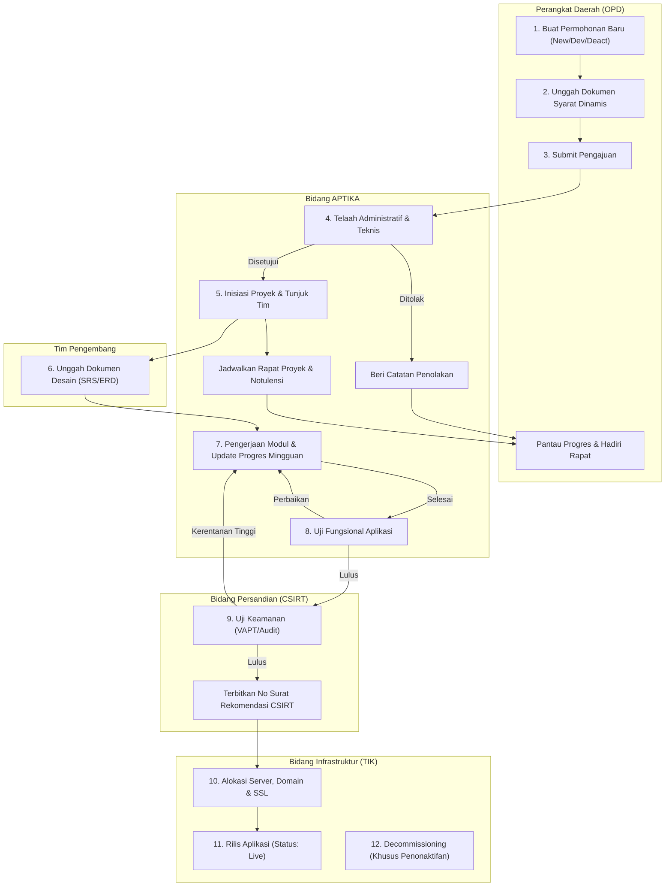
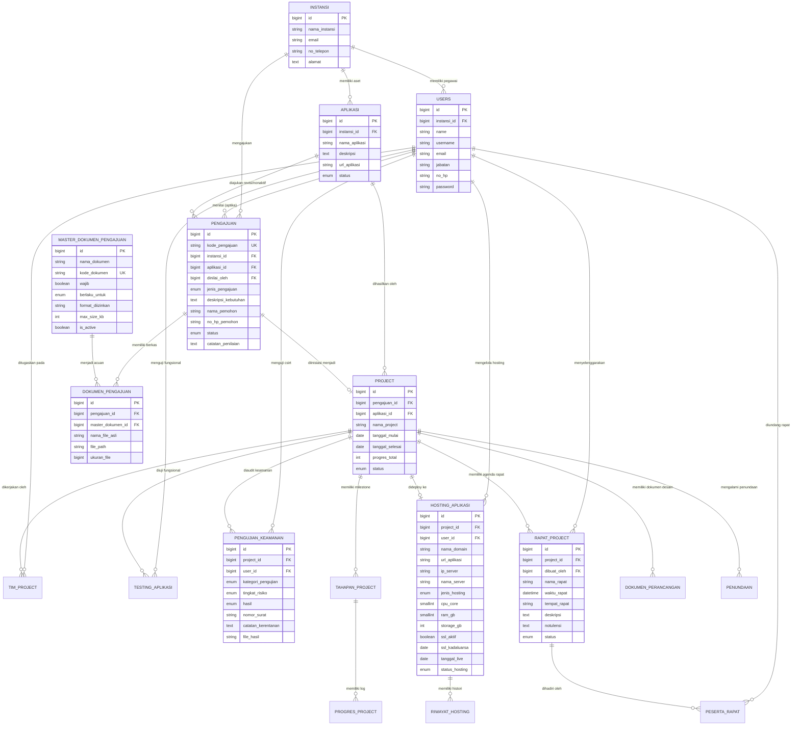

# BAB III. PERANCANGAN SISTEM

Rancangan sistem ini disusun mengikuti tahapan yang terdapat dalam metodologi *Rapid Application Development* (RAD). Metodologi RAD dipilih karena memungkinkan pengembangan sistem dilakukan secara iteratif, adaptif terhadap perubahan kebutuhan, serta melibatkan koordinasi intensif antara pihak pengembang dan pemangku kepentingan (*stakeholders*) di lingkungan Dinas Komunikasi, Informatika dan Statistik (Diskominfotik) Provinsi Riau.

Tahapan RAD yang dilaksanakan terdiri atas tiga fase utama:
1. **Requirement Planning (Perencanaan Kebutuhan)**
2. **RAD Design Workshop (Lokakarya Perancangan Sistem)**
3. **Implementation (Implementasi Sistem)**

---

## 3.1 Requirement Planning (Perencanaan Kebutuhan)

Pada tahap ini, dilakukan analisis mendalam terhadap proses bisnis dan alur birokrasi pengelolaan aplikasi pada Diskominfotik Provinsi Riau. Berdasarkan koordinasi dan analisis kebutuhan, dirumuskan batasan input, proses, output, arsitektur teknologi, serta kebutuhan fungsional dan non-fungsional sistem.

### 3.1.1 Input Sistem
Input sistem merupakan data dan berkas yang dimasukkan oleh para pengguna sesuai peran masing-masing:
1. **Perangkat Daerah (OPD):** Kredensial akun instansi, formulir pengajuan aplikasi (nama aplikasi, deskripsi kebutuhan, nama dan kontak PIC pemohon), berkas proposal, surat permohonan resmi, serta berkas persyaratan dinamis sesuai jenis pengajuan (*new app*, *development*, *deactivation*).
2. **Superadmin:** Data master instansi OPD, master akun pengguna beserta penetapan peran (*role*), data master aplikasi eksisting, dan master konfigurasi dokumen pengajuan (format, batasan ukuran, kewajiban unggah).
3. **Admin Bidang APTIKA:** Hasil telaah pengajuan (status persetujuan, catatan telaah), data inisiasi proyek (nama proyek, estimasi waktu pengerjaan, susunan tim teknis), berkas hasil uji fungsional, serta data agenda rapat koordinasi (surat undangan, agenda, waktu, tempat/link, notulensi hasil rapat).
4. **Tim Pengembang (Ketua & Anggota Tim):** Rencana tahapan/milestone proyek, persentase progres, catatan log progres berkala/mingguan, berkas rancangan teknis (SRS, wireframe, ERD), dan formulir permohonan penundaan proyek (*delay*).
5. **Admin Bidang Persandian (CSIRT):** Kategori pengujian keamanan (*Vulnerability Assessment, Penetration Testing, Source Code Review, Audit Konfigurasi*), tingkat risiko keamanan (*aman, rendah, sedang, tinggi, kritis*), berkas laporan audit keamanan, rekomendasi mitigasi, serta nomor surat rekomendasi kelaikan operasi.
6. **Admin Bidang Infrastruktur (TIK):** Data teknis *deployment* dan *hosting* (nama domain/URL, IP server, nama server, jenis hosting, spesifikasi CPU/RAM/Storage, web server, database server, status SSL, masa berlaku SSL, tanggal *go-live*), catatan log perubahan spesifikasi hosting, serta eksekusi penonaktifan aplikasi (*decommissioning*).

### 3.1.2 Proses yang Berjalan dalam Sistem
Sistem beroperasi melalui hak akses terautentikasi berbasis *Role-Based Access Control* (RBAC):
1. **Autentikasi & Autorisasi:** Seluruh pengguna (Superadmin, OPD, Admin APTIKA, Admin Infrastruktur, Admin Persandian, Ketua/Anggota Tim, dan Pimpinan Eksekutif) wajib masuk melalui antarmuka *single-login* menggunakan *username* dan *password*. Sistem mengarahkan pengguna secara otomatis ke dashboard kerja sesuai hak aksesnya.
2. **Pengajuan & Verifikasi Berkas:** OPD mengajukan usulan secara terstruktur. Sistem memvalidasi kelengkapan berkas berdasarkan master dokumen dinamis. Admin APTIKA menelaah kelayakan administratif dan teknis.
3. **Inisiasi & Manajemen Proyek:** Usulan yang disetujui diubah menjadi proyek aktif. Admin APTIKA menunjuk Ketua Tim dan Anggota Tim internal. Tim mencatat *milestone* dan progres pengerjaan yang dapat dipantau secara transparan.
4. **Kolaborasi Rapat Proyek:** Penyelenggara menjadwalkan rapat koordinasi, mengundang personil teknis dan perwakilan OPD, mengirim notifikasi, serta mendokumentasikan notulensi rapat secara terpusat.
5. **Pengujian Bertingkat (Two-Stage Verification):**
   - *Tahap 1 (Uji Fungsional):* Diverifikasi oleh Admin APTIKA untuk memastikan kesesuaian fitur aplikasi dengan spesifikasi kebutuhan.
   - *Tahap 2 (Uji Keamanan Informasi):* Dilakukan oleh Tim CSIRT Bidang Persandian untuk mendeteksi kerentanan keamanan sebelum aplikasi diizinkan rilis publik.
6. **Deployment & Manajemen Infrastruktur:** Admin Infrastruktur memproses proyek yang telah lulus uji keamanan untuk dialokasikan sumber daya server, domain terdaftar, sertifikat SSL, dan status aplikasi diubah menjadi *Live*.

### 3.1.3 Output Sistem
Output yang dihasilkan oleh sistem meliputi:
1. Kode unik registrasi pengajuan (*tracking code*) dan riwayat status telaah usulan bagi OPD.
2. Dasbor pemantauan siklus hidup aplikasi (*application lifecycle dashboard*) untuk manajemen dan pimpinan.
3. Notulensi rapat resmi dan dokumentasi kegiatan proyek yang dapat diunduh para peserta.
4. Lembar verifikasi hasil pengujian fungsional aplikasi.
5. Dokumen rekomendasi kelaikan operasi dan laporan hasil uji penetrasi (CSIRT).
6. Buku inventaris dan riwayat perubahan konfigurasi server/hosting (*audit trail infrastructure*).
7. Laporan rekapitulasi portofolio aplikasi dan kinerja penyelesaian proyek di lingkungan Pemerintah Provinsi Riau.

### 3.1.4 Arsitektur Teknologi & Lingkungan Pengembangan
Teknologi yang digunakan dalam pembangunan sistem ini dirancang dengan standar arsitektur web modern yang andal, aman, dan mudah dipelihara:
1. **Basis Data (Database):** MySQL versi 8.0, dikelola melalui fitur migrasi (*Laravel Migrations*) dan relasi *Eloquent ORM*.
2. **Backend Framework:** Laravel versi 12 (berbasis PHP 8.3) dengan penerapan arsitektur *Model-View-Controller* (MVC), *Form Request Validation*, dan *Eloquent API/Resource*.
3. **Autentikasi & Otorisasi:** Laravel Auth session-based dikombinasikan dengan pustaka `spatie/laravel-permission` untuk pengaturan hak akses berbasis peran (*Role-Based Access Control*).
4. **Frontend Interface:** Laravel Blade Template Engine yang dipadukan dengan Tailwind CSS untuk menghasilkan antarmuka pengguna yang responsif, modern, dan modular.
5. **Penyimpanan Berkas (File Storage):** Laravel Storage System dengan isolasi dokumen terproteksi (*private disk*) untuk berkas sensitif pengujian keamanan.

---

### 3.1.5 Kebutuhan Fungsional (Functional Requirements)

Berikut adalah daftar kebutuhan fungsional sistem yang dikelompokkan berdasarkan peran aktor:

#### 1. Perangkat Daerah (OPD)
Tabel 3.1 Kebutuhan Fungsional Perangkat Daerah (OPD)
| No | Kode | Kebutuhan Fungsional | Deskripsi |
|:---|:---|:---|:---|
| 1 | FR-OPD-01 | Autentikasi Pengguna | OPD dapat melakukan login dan logout menggunakan akun instansi resmi yang terdaftar. |
| 2 | FR-OPD-02 | Pengajuan Aplikasi Baru (*New App*) | OPD dapat mengajukan permohonan pembangunan aplikasi baru dengan melampirkan profil kebutuhan dan berkas pendukung wajib. |
| 3 | FR-OPD-03 | Pengajuan Pengembangan (*App Development*) | OPD dapat mengajukan usulan penambahan modul/fitur baru pada aplikasi eksisting yang telah berstatus aktif. |
| 4 | FR-OPD-04 | Pengajuan Penonaktifan (*Deactivation*) | OPD dapat mengajukan permohonan penghentian/penonaktifan aplikasi yang sudah tidak relevan digunakan. |
| 5 | FR-OPD-05 | Unggah Berkas Persyaratan Dinamis | OPD dapat mengunggah berkas persyaratan sesuai ketentuan dinamis yang ditetapkan oleh pengelola sistem. |
| 6 | FR-OPD-06 | Monitoring Status Pengajuan & Proyek | OPD dapat memantau progres telaah usulan, status tahapan pengerjaan proyek, dan hasil verifikasi secara berkala. |
| 7 | FR-OPD-07 | Partisipasi Rapat Koordinasi | OPD dapat menerima undangan rapat koordinasi proyek, melihat jadwal, dan mengunduh notulensi hasil rapat. |
| 8 | FR-OPD-08 | Daftar Inventaris Aplikasi Instansi | OPD dapat melihat katalog seluruh aplikasi yang dimiliki oleh instansinya beserta status operasionalnya. |

#### 2. Superadmin
Tabel 3.2 Kebutuhan Fungsional Superadmin
| No | Kode | Kebutuhan Fungsional | Deskripsi |
|:---|:---|:---|:---|
| 1 | FR-ADM-01 | Manajemen Data Instansi | Superadmin dapat mengelola (tambah, lihat, ubah, hapus) data Perangkat Daerah/OPD di Provinsi Riau. |
| 2 | FR-ADM-02 | Manajemen Pengguna (*User Management*) | Superadmin dapat mengelola akun pengguna, mengatur jabatan, kontak, instansi, serta menetapkan peran akses (*roles*). |
| 3 | FR-ADM-03 | Manajemen Master Aplikasi | Superadmin dapat mengelola direktori master aplikasi pemerintah provinsi beserta status operasionalnya. |
| 4 | FR-ADM-04 | Manajemen Master Dokumen Pengajuan | Superadmin dapat mengatur jenis berkas persyaratan pengajuan, format file, batas ukuran berkas, kewajiban unggah, dan mengaktifkan/menonaktifkan dokumen persyaratan secara dinamis. |
| 5 | FR-ADM-05 | Monitoring Sistem Terpusat | Superadmin memiliki akses pengawasan ke seluruh data transaksi, log aktivitas, dan status entitas proyek. |

#### 3. Admin Bidang APTIKA
Tabel 3.3 Kebutuhan Fungsional Admin Bidang APTIKA
| No | Kode | Kebutuhan Fungsional | Deskripsi |
|:---|:---|:---|:---|
| 1 | FR-APT-01 | Telaah Permohonan Usulan | Admin APTIKA dapat menelaah proposal dan berkas pengajuan OPD, lalu menetapkan status (*Approved* atau *Rejected*) disertai catatan hasil telaah. |
| 2 | FR-APT-02 | Inisiasi Proyek Pengembangan | Admin APTIKA dapat membuat entitas proyek baru dari permohonan yang telah disetujui serta menentukan estimasi jadwal pelaksanaan. |
| 3 | FR-APT-03 | Pembentukan Tim Proyek (*Team Assignment*) | Admin APTIKA dapat menunjuk Ketua Tim (*Lead Developer*) dan menetapkan anggota tim teknis dari daftar personil internal. |
| 4 | FR-APT-04 | Manajemen Rapat Proyek | Admin APTIKA dapat menjadwalkan rapat koordinasi, menetapkan agenda dan lokasi, mengundang personil teknis serta perwakilan OPD, dan mengunggah notulensi resmi. |
| 5 | FR-APT-05 | Verifikasi Uji Fungsional Aplikasi | Admin APTIKA dapat melakukan pengujian fungsional sistem, mencatat temuan pengujian, mengunggah laporan uji, dan menetapkan status kelulusan (*Lulus / Tidak Lulus / Perbaikan*). |
| 6 | FR-APT-06 | Pengendalian Status Siklus Proyek | Admin APTIKA dapat memperbarui status siklus proyek (inisiasi, pengerjaan, uji fungsional, rekomendasi keamanan, hingga penyerahan ke infrastruktur). |

#### 4. Tim Pengembang (Ketua Tim & Anggota Tim)
Tabel 3.4 Kebutuhan Fungsional Tim Pengembang Proyek
| No | Kode | Kebutuhan Fungsional | Deskripsi |
|:---|:---|:---|:---|
| 1 | FR-DEV-01 | Akses Lembar Kerja Proyek | Tim dapat melihat daftar proyek yang ditugaskan kepada mereka beserta rincian kebutuhan sistem. |
| 2 | FR-DEV-02 | Pengelolaan Dokumen Perancangan | Tim dapat mengunggah berkas rancangan teknis (SRS, Mockup/Wireframe, ERD, Arsitektur Sistem). |
| 3 | FR-DEV-03 | Pembaruan Milestone & Tahapan Proyek | Tim dapat membagi proyek ke dalam beberapa tahapan pengerjaan dan memperbarui bobot persentase capaian. |
| 4 | FR-DEV-04 | Pencatatan Log Progres & Notulensi Kerja | Tim dapat mencatat histori aktivitas pengerjaan rutin, hambatan teknis, dan catatan perkembangan mingguan. |
| 5 | FR-DEV-05 | Pengajuan Penundaan Proyek (*Delay/Hold*) | Ketua Tim dapat mengajukan permohonan penundaan proyek jika terdapat kendala eksternal kritis beserta surat permohonan resmi. |

#### 5. Admin Bidang Persandian (CSIRT)
Tabel 3.5 Kebutuhan Fungsional Admin Bidang Persandian
| No | Kode | Kebutuhan Fungsional | Deskripsi |
|:---|:---|:---|:---|
| 1 | FR-CSIRT-01 | Antrean Pengujian Keamanan | Admin Persandian dapat melihat antrean aplikasi yang telah lulus uji fungsional dan siap diuji keamanannya. |
| 2 | FR-CSIRT-02 | Input Hasil Uji Keamanan Informasi | Admin Persandian dapat menginput hasil pengujian keamanan berdasarkan kategori (*Vulnerability Assessment, Penetration Testing, Source Code Review, Audit Konfigurasi*). |
| 3 | FR-CSIRT-03 | Penetapan Tingkat Risiko Keamanan | Admin Persandian dapat menetapkan skor/tingkat risiko kerentanan (*Aman, Rendah, Sedang, Tinggi, Kritis*) dan mencatat detail celah keamanan yang ditemukan. |
| 4 | FR-CSIRT-04 | Rekomendasi Mitigasi & Kelaikan Operasi | Admin Persandian dapat memberikan rekomendasi teknis perbaikan, mengunggah berkas laporan pengujian, menginput nomor surat rekomendasi CSIRT, dan menetapkan status kelulusan (*Lulus / Tidak Lulus / Perbaikan*). |
| 5 | FR-CSIRT-05 | Riwayat Audit Keamanan | Admin Persandian dapat meninjau riwayat riwayat pengujian keamanan dari seluruh aplikasi pemerintah. |

#### 6. Admin Bidang Infrastruktur (TIK)
Tabel 3.6 Kebutuhan Fungsional Admin Bidang Infrastruktur
| No | Kode | Kebutuhan Fungsional | Deskripsi |
|:---|:---|:---|:---|
| 1 | FR-INF-01 | Antrean Proyek Siap Deployment | Admin Infrastruktur dapat melihat daftar proyek yang telah dinyatakan lulus uji fungsional dan lulus uji keamanan informasi. |
| 2 | FR-INF-02 | Alokasi Lingkungan Hosting & Server | Admin Infrastruktur dapat menginput konfigurasi server produksi meliputi alokasi nama domain resmi (riau.go.id), IP server, spesifikasi CPU, RAM, Storage, Web Server, dan Database Server. |
| 3 | FR-INF-03 | Konfigurasi Keamanan Jaringan & SSL | Admin Infrastruktur dapat mencatat status sertifikat SSL dan masa berlakunya guna menjamin komunikasi data terenkripsi. |
| 4 | FR-INF-04 | Eksekusi Go-Live Proyek | Admin Infrastruktur dapat mengesahkan aplikasi menjadi aktif (*live*) dan mencatat tanggal operasional perdana. |
| 5 | FR-INF-05 | Riwayat & Pembaruan Konfigurasi (*Audit Trail*) | Sistem mencatat histori setiap perubahan spesifikasi atau migrasi server hosting ke dalam riwayat hosting secara otomatis. |
| 6 | FR-INF-06 | Eksekusi Penonaktifan Aplikasi | Admin Infrastruktur dapat mengeksekusi permohonan penonaktifan aplikasi (*decommissioning server*), mematikan instans hosting, dan memperbarui status aplikasi menjadi nonaktif. |

#### 7. Pimpinan Eksekutif (Kepala Bidang & Kepala Dinas)
Tabel 3.7 Kebutuhan Fungsional Pimpinan Eksekutif
| No | Kode | Kebutuhan Fungsional | Deskripsi |
|:---|:---|:---|:---|
| 1 | FR-EKS-01 | Dashboard Eksekutif Terpadu | Pimpinan dapat melihat ringkasan statistik permohonan masuk, jumlah proyek aktif, distribusi beban tim pengembang, dan status operasional aplikasi se-Provinsi Riau. |
| 2 | FR-EKS-02 | Monitoring Progres & Bottleneck Proyek | Pimpinan dapat memantau proyek yang mengalami hambatan (*delayed* atau *perbaikan* uji) serta memantau tingkat risiko keamanan aplikasi. |
| 3 | FR-EKS-03 | Laporan Rekapitulasi Tahunan | Pimpinan dapat melihat laporan portofolio pengembangan teknologi informasi di lingkungan Pemprov Riau. |

---

### 3.1.6 Kebutuhan Non-Fungsional (Non-Functional Requirements)
Tabel 3.8 Kebutuhan Non-Fungsional Sistem
| Parameter | Spesifikasi / Target |
|:---|:---|
| **Keamanan (Security)** | 1. Sandi pengguna dienkripsi menggunakan algoritma *Bcrypt*.<br>2. Proteksi terhadap serangan web umum melalui mekanisme *CSRF Protection, SQL Injection Escaping (Eloquent PDO),* dan *XSS Filtering* bawaan Laravel.<br>3. Autorisasi ketat berbasis middleware peran (*Role Middleware*).<br>4. Dokumen laporan audit CSIRT disimpan pada direktori terlindungi (*private storage*). |
| **Ketersediaan & Keandalan (Reliability)** | Sistem dirancang untuk mampu melayani permintaan transaksi 24/7 dengan arsitektur database relasional terindeks (*Indexed Foreign Keys* dan *Unique Constraints*). |
| **Kinerja (Performance)** | Waktu respon halaman rata-rata di bawah 1,5 detik pada jaringan internal/intranet dinas, optimalisasi beban aset CSS/JS menggunakan kompilasi *Vite bundler*. |
| **Kompatibilitas & Usability** | Antarmuka berbasis *Responsive Web Design* yang kompatibel pada peramban modern (Google Chrome, Mozilla Firefox, Microsoft Edge, Safari) baik pada perangkat komputer kerja maupun tablet. |

---

### 3.1.7 Analisis Proses Bisnis

Proses bisnis pengelolaan aplikasi pada Diskominfotik Provinsi Riau dibagi menjadi lima alur kerja utama yang saling berkesinambungan:



1. **Alur Pengajuan dan Verifikasi Usulan:** OPD yang telah memiliki akun masuk ke sistem, memilih jenis pengajuan (*Aplikasi Baru, Pengembangan, atau Penonaktifan*), mengisi formulir spesifikasi, dan mengunggah berkas persyaratan wajib. Berkas masuk ke antrean telaah Bidang APTIKA.
2. **Alur Inisiasi Proyek & Penugasan Tim:** Permohonan yang disetujui dialihkan menjadi proyek resmi. Admin APTIKA menunjuk Ketua Tim dan Anggota Tim pengembang. Ketua Tim menyusun tahapan *milestone* dan persentase bobot capaian.
3. **Alur Rapat Koordinasi & Kolaborasi:** Selama siklus pengerjaan, diselenggarakan rapat koordinasi (*kick-off, evaluasi sprint, atau harmonisasi teknis*). Sistem mengundang seluruh pihak terkait dan menyimpan risalah notulensi secara digital.
4. **Alur Verifikasi Bertingkat (Uji Fungsional & Uji CSIRT):** Setelah aplikasi selesai dikembangkan oleh tim, aplikasi terlebih dahulu diuji fungsinya oleh Admin APTIKA. Jika lulus, aplikasi diteruskan ke Bidang Persandian untuk dilakukan audit keamanan (*Penetration Testing*). Apabila ditemukan kerentanan, laporan audit dikembalikan ke tim pengembang untuk ditambal hingga dinyatakan lulus.
5. **Alur Deployment & Manajemen Siklus Operasional:** Aplikasi yang telah mengantongi rekomendasi resmi dari CSIRT diserahkan kepada Bidang Infrastruktur untuk dipetakan ke server produksi, dikonfigurasi domain dinas, serta dipasang sertifikat SSL. Aplikasi dinyatakan resmi aktif (*Live*). Apabila di kemudian hari diajukan penonaktifan, Bidang Infrastruktur mengeksekusi penonaktifan server dan mengubah status menjadi nonaktif.

---

### 3.1.8 Analisis Use Case

#### 1. Identifikasi Aktor
Tabel 3.9 Identifikasi Aktor Sistem
| Nama Aktor | Deskripsi Peran |
|:---|:---|
| **Perangkat Daerah (OPD)** | Instansi pemohon yang mengajukan pembangunan, pengembangan, atau penonaktifan aplikasi serta memantau progres pelaksanaan. |
| **Superadmin** | Pengelola utama sistem yang bertugas memelihara data master instansi, akun pengguna, hak akses, katalog aplikasi, dan master dokumen persyaratan. |
| **Admin Bidang APTIKA** | Penelaah usulan permohonan, penanggung jawab inisiasi proyek, pengatur susunan tim teknis, penyelenggara rapat proyek, dan penguji fungsional aplikasi. |
| **Tim Pengembang (Ketua & Anggota Tim)** | Personil teknis pengembang yang merancang arsitektur sistem, membangun kode program, mencatat progres mingguan, dan mengajukan penundaan jika terjadi hambatan. |
| **Admin Bidang Persandian (CSIRT)** | Penilai aspek keamanan informasi yang melakukan *vulnerability assessment* dan pengujian penetrasi serta menerbitkan rekomendasi kelaikan sistem. |
| **Admin Bidang Infrastruktur (TIK)** | Pengelola arsitektur server, alokasi subdomain, sertifikat SSL, pemeliharaan riwayat hosting, dan pelaksana *decommissioning* aplikasi. |
| **Pimpinan Eksekutif (Kepala Bidang / Dinas)** | Manajemen pengawas yang memantau performa proyek, statistik pengajuan, dan portofolio aplikasi se-Provinsi Riau. |

#### 2. Daftar Use Case Utama
Berikut adalah relasi pemetaan fungsi utama ke para aktor:
1. `UC-01` Melakukan Login dan Logout (Semua Aktor)
2. `UC-02` Mengelola Master Data Instansi & Pengguna (Superadmin)
3. `UC-03` Mengelola Master Dokumen Persyaratan (Superadmin)
4. `UC-04` Mengajukan Usulan Aplikasi (OPD)
5. `UC-05` Memantau Status Pengajuan & Proyek (OPD, Pimpinan Eksekutif)
6. `UC-06` Menelaah & Menyetujui Permohonan OPD (Admin APTIKA)
7. `UC-07` Menginisiasi Proyek & Membentuk Tim (Admin APTIKA)
8. `UC-08` Mengelola Rapat Proyek & Notulensi (Admin APTIKA, OPD, Tim)
9. `UC-09` Mengelola Milestone & Log Progres Proyek (Ketua Tim, Anggota Tim)
10. `UC-10` Mengajukan Penundaan Proyek (Ketua Tim)
11. `UC-11` Melakukan Uji Fungsional Aplikasi (Admin APTIKA)
12. `UC-12` Melakukan Uji Keamanan Informasi CSIRT (Admin Persandian)
13. `UC-13` Mengalokasikan Server & Deployment Hosting (Admin Infrastruktur)
14. `UC-14` Mengelola Riwayat Konfigurasi Hosting (Admin Infrastruktur)
15. `UC-15` Eksekusi Penonaktifan Aplikasi (Admin Infrastruktur)
16. `UC-16` Monitoring Dashboard Eksekutif (Pimpinan Eksekutif)

#### 3. Skenario Use Case Terpilih

##### Skenario 1: Melakukan Login ke Sistem
Tabel 3.10 Skenario Use Case Login
| Elemen | Deskripsi |
|:---|:---|
| **Nama Use Case** | Melakukan Login ke Sistem |
| **Aktor** | Seluruh Aktor Terdaftar |
| **Kondisi Awal** | Pengguna mengakses halaman login sistem dan belum terautentikasi. |
| **Kondisi Akhir** | Pengguna berhasil masuk ke dashboard sesuai perannya masing-masing. |
| **Skenario Normal** | 1. Pengguna memasukkan *username* dan *password*.<br>2. Pengguna menekan tombol "Masuk ke Sistem".<br>3. Sistem memverifikasi kecocokan kredensial dan keaktifan akun pengguna.<br>4. Sistem mengenali peran (*role*) pengguna dan mengarahkan ke dashboard yang relevan. |
| **Skenario Alternatif** | 1. Kredensial tidak cocok: Sistem menampilkan pesan galat "Username atau password yang Anda masukkan salah".<br>2. Akun tidak aktif: Sistem menampilkan pesan "Akun Anda dinonaktifkan, hubungi administrator". |

##### Skenario 2: Mengajukan Usulan Aplikasi Baru / Pengembangan
Tabel 3.11 Skenario Use Case Pengajuan Usulan
| Elemen | Deskripsi |
|:---|:---|
| **Nama Use Case** | Mengajukan Usulan Aplikasi |
| **Aktor** | Perangkat Daerah (OPD) |
| **Kondisi Awal** | OPD telah berhasil login dan berada pada menu Pengajuan Usulan. |
| **Kondisi Akhir** | Pengajuan tersimpan dengan kode unik, berkas terunggah, status `submitted`. |
| **Skenario Normal** | 1. OPD memilih jenis pengajuan (*Aplikasi Baru, Pengembangan, Penonaktifan*).<br>2. Mengisi formulir spesifikasi kebutuhan, nama PIC, dan kontak narahubung.<br>3. Sistem menampilkan daftar dokumen yang wajib diunggah sesuai konfigurasi master dokumen aktif.<br>4. OPD mengunggah berkas-berkas persyaratan dalam format yang diizinkan (PDF).<br>5. Menekan tombol "Kirim Pengajuan".<br>6. Sistem memvalidasi ukuran dan format berkas, men-generate kode unik pengajuan, dan menyimpan data. |
| **Skenario Alternatif** | Terdapat berkas wajib yang belum diunggah atau ukuran berkas melebihi batas: Sistem menolak penyimpanan dan memberikan notifikasi kolom berkas yang bermasalah. |

##### Skenario 3: Penelaahan Permohonan Usulan OPD
Tabel 3.12 Skenario Use Case Penelaahan Permohonan
| Elemen | Deskripsi |
|:---|:---|
| **Nama Use Case** | Menelaah Permohonan Usulan |
| **Aktor** | Admin Bidang APTIKA |
| **Kondisi Awal** | Terdapat permohonan berstatus `submitted` dalam antrean telaah APTIKA. |
| **Kondisi Akhir** | Permohonan diperbarui menjadi `approved` atau `rejected` beserta catatan resmi. |
| **Skenario Normal** | 1. Admin APTIKA membuka daftar permohonan masuk.<br>2. Membuka detail usulan dan mengunduh berkas kelengkapan yang diajukan OPD.<br>3. Melakukan telaah kelayakan teknis dan arsitektur.<br>4. Memilih keputusan (*Setujui / Tolak*), memasukkan catatan telaah, dan menyimpan hasil telaah.<br>5. Jika disetujui, sistem membuka opsi inisiasi pembentukan proyek. |
| **Skenario Alternatif** | Keputusan ditolak tanpa mengisi catatan pertimbangan: Sistem menampilkan peringatan "Catatan telaah wajib diisi apabila permohonan ditolak". |

##### Skenario 4: Pengujian Keamanan Informasi CSIRT
Tabel 3.13 Skenario Use Case Pengujian Keamanan CSIRT
| Elemen | Deskripsi |
|:---|:---|
| **Nama Use Case** | Melakukan Uji Keamanan Informasi |
| **Aktor** | Admin Bidang Persandian (CSIRT) |
| **Kondisi Awal** | Proyek telah dinyatakan lulus uji fungsional oleh Bidang APTIKA (`security_testing`). |
| **Kondisi Akhir** | Status uji keamanan tersimpan (`lulus`/`perbaikan`), nomor surat tercatat, dan dokumen audit terunggah. |
| **Skenario Normal** | 1. Admin Persandian memilih proyek dari antrean uji keamanan.<br>2. Memilih kategori uji (*Vulnerability Assessment / Penetration Testing / Code Review*).<br>3. Menginput tingkat risiko temuan (*Aman, Rendah, Sedang, Tinggi, Kritis*).<br>4. Mengunggah laporan pengujian resmi dan menginput catatan rekomendasi perbaikan.<br>5. Menetapkan keputusan akhir (*Lulus / Perbaikan*). Jika lulus, menginput nomor surat rekomendasi CSIRT.<br>6. Menekan tombol simpan verifikasi keamanan. |
| **Skenario Alternatif** | Jika status akhir ditetapkan "Perbaikan", sistem mengubah status proyek menjadi perbaikan dan mengirimkan notifikasi kepada tim pengembang beserta ringkasan kerentanan yang wajib ditambal. |

##### Skenario 5: Alokasi Hosting & Eksekusi Deployment
Tabel 3.14 Skenario Use Case Alokasi Hosting & Deployment
| Elemen | Deskripsi |
|:---|:---|
| **Nama Use Case** | Alokasi Hosting & Eksekusi Deployment |
| **Aktor** | Admin Bidang Infrastruktur (TIK) |
| **Kondisi Awal** | Proyek telah lulus uji fungsional dan lulus uji keamanan informasi CSIRT. |
| **Kondisi Akhir** | Konfigurasi server tercatat, status proyek menjadi `live`, dan aplikasi aktif. |
| **Skenario Normal** | 1. Admin Infrastruktur membuka daftar antrean deployment.<br>2. Mengisi spesifikasi server: alokasi domain (contoh: app.riau.go.id), IP server publik, jenis hosting (VPS/Cloud), spesifikasi CPU/RAM/Storage, web server, database, status SSL, dan tanggal operasional perdana.<br>3. Menekan tombol "Simpan & Rilis Aplikasi (Go-Live)".<br>4. Sistem menyimpan konfigurasi, memperbarui status proyek menjadi `live`, dan mencatat riwayat perubahan. |
| **Skenario Alternatif** | Format penamaan domain tidak valid atau IP server bentrok: Sistem memunculkan notifikasi validasi format input. |

---

## 3.2 RAD Design Workshop (Lokakarya Perancangan Sistem)

Fase *Design Workshop* adalah tahap penerjemahan kebutuhan pengguna ke dalam representasi arsitektur perangkat lunak, struktur basis data, serta tata letak antarmuka visual.

### 3.2.1 Arsitektur Sistem
Sistem dibangun mengadopsi arsitektur *3-Tier Client-Server Architecture* terdistribusi:
1. **Presentation Tier (Client Side):** Berjalan pada peramban web pengguna menggunakan HTML5, Tailwind CSS, dan JavaScript interaktif yang di-render secara modular oleh Laravel Blade Engine.
2. **Application / Logic Tier (Server Side):** Ditenagai oleh Web Server (Nginx/Apache) dan PHP 8.3 yang menjalankan kerangka kerja Laravel 12. Lapisan ini memproses logika bisnis, validasi masukan (*Form Requests*), pengendalian alur kerja (*Controllers*), dan manajemen hak akses pengguna (*Middleware & Policies*).
3. **Data Tier (Database Server):** Berupa RDBMS MySQL 8.0 yang mengelola integritas data secara relasional dengan dukungan transaksi *ACID* (*Atomicity, Consistency, Isolation, Durability*), relasi kunci asing (*Foreign Keys*), serta penyimpanan berkas fisik (*Local/Storage Driver*).

```
[ Pengguna: OPD / APTIKA / CSIRT / INFRA / Pimpinan ]
                       │
             (HTTPS Request / Web Browser)
                       ▼
┌────────────────────────────────────────────────────────┐
│                   WEB & APPLICATION SERVER             │
│  - Nginx Web Server + PHP 8.3                          │
│  - Laravel MVC Engine                                  │
│  - Middleware Autentikasi & Spatie RBAC                │
│  - File Storage Driver (Dokumen Proposal & CSIRT)      │
└────────────────────────────────────────────────────────┘
                       │
              (TCP/IP Port 3306 - PDO)
                       ▼
┌────────────────────────────────────────────────────────┐
│                    DATABASE SERVER                     │
│  - MySQL 8.0 Relational DBMS                           │
│  - Skema Relasi Proyek, Pengujian, Hosting, Rapat      │
└────────────────────────────────────────────────────────┘
```

---

### 3.2.2 Entity Relationship Diagram (ERD)

Sistem mengelola relasi komprehensif antar entitas untuk mendukung seluruh siklus hidup aplikasi pemerintah.

#### 1. Identifikasi Entitas Utama
1. **`instansi`**: Menyimpan data identitas Organisasi Perangkat Daerah (OPD).
2. **`users`**: Menyimpan data akun seluruh pengguna internal dan eksternal.
3. **`roles` & `model_has_roles`**: Mengatur penugasan hak akses pengguna.
4. **`aplikasi`**: Master data aplikasi daerah dan riwayat kepemilikan oleh instansi.
5. **`master_dokumen_pengajuan`**: Master konfigurasi persyaratan dokumen pengajuan yang dinamis.
6. **`pengajuan`**: Transaksi permohonan usulan aplikasi dari OPD.
7. **`dokumen_pengajuan`**: Berkas fisik yang diunggah OPD per pengajuan berdasarkan master dokumen.
8. **`project`**: Entitas proyek pengembangan yang diinisiasi dari pengajuan yang disetujui.
9. **`tim_project`**: Relasi anggota personil teknis yang ditugaskan pada setiap proyek.
10. **`tahapan_project`**: Daftar *milestone* dan target persentase setiap fase pengerjaan proyek.
11. **`progres_project`**: Log entri perkembangan rutin dan notulensi kerja berkala.
12. **`dokumen_perancangan`**: Berkas rekayasa perangkat lunak (SRS, Wireframe, ERD, Arsitektur).
13. **`testing_aplikasi`**: Hasil verifikasi pengujian fungsional oleh Bidang APTIKA.
14. **`pengujian_keamanan`**: Hasil audit keamanan, skor risiko, dan nomor surat rekomendasi CSIRT.
15. **`hosting_aplikasi`**: Konfigurasi teknis server produksi, domain, dan sertifikat SSL.
16. **`riwayat_hosting`**: Catatan riwayat audit (*audit log*) dari setiap perubahan spesifikasi hosting.
17. **`rapat_project`**: Agenda rapat koordinasi proyek, surat undangan, dan notulensi resmi.
18. **`peserta_rapat`**: Daftar personil internal dan perwakilan OPD yang diundang ke rapat.
19. **`penundaan`**: Riwayat dan alasan penundaan proyek (*hold/delayed*).

#### 2. Diagram ERD (Mermaid)



---

### 3.2.3 Rancangan Antarmuka Pengguna (Mockup)

Rancangan antarmuka dirancang dengan pendekatan *user-centered design* untuk mempermudah operasional birokrasi yang kompleks.

Tabel 3.15 Deskripsi Rancangan Antarmuka Sistem
| No | Nama Antarmuka | Aktor Pengguna | Deskripsi Rancangan Halaman |
|:---|:---|:---|:---|
| 1 | **Halaman Login Terpadu** | Seluruh Aktor | Menampilkan formulir kredensial *username* dan *password* dengan validasi visual interaktif serta proteksi *brute-force*. |
| 2 | **Dashboard OPD** | OPD | Menampilkan ringkasan status pengajuan usulan, tombol buat pengajuan baru, katalog aplikasi aktif milik OPD, serta agenda rapat yang mengundang OPD. |
| 3 | **Formulir Pengajuan Usulan Dinamis** | OPD | Formulir bertahap yang secara otomatis menyesuaikan kolom dokumen persyaratan yang wajib diunggah berdasarkan konfigurasi master dokumen. |
| 4 | **Dashboard & Telaah APTIKA** | Admin APTIKA | Menampilkan tabel antrean telaah permohonan dengan filter status, modul peninjauan dokumen terlampir, serta panel penetapan persetujuan/penolakan. |
| 5 | **Form Inisiasi Proyek & Tim** | Admin APTIKA | Antarmuka pemilihan personil internal untuk ditugaskan sebagai Ketua Tim dan Anggota Tim pada proyek yang baru disetujui. |
| 6 | **Modul Rapat & Notulensi Proyek** | Admin APTIKA & Tim | Kalender dan daftar agenda rapat proyek, fitur pemilihan peserta internal dan OPD, form unggah surat undangan, serta editor notulensi hasil rapat. |
| 7 | **Lembar Kerja Proyek & Progres** | Tim Pengembang | Panel pemantauan *milestone* tahapan proyek, formulir pembaruan persentase pengerjaan, dan pencatatan log kemajuan mingguan. |
| 8 | **Modul Pengujian CSIRT** | Admin Persandian | Antarmuka pengujian kerentanan keamanan, pemilihan jenis uji VAPT, input skor risiko, unggah berkas laporan audit, dan input nomor surat rekomendasi CSIRT. |
| 9 | **Panel Deployment & Server Hosting** | Admin Infrastruktur | Formulir pencatatan spesifikasi teknis server produksi (Domain, IP, CPU/RAM/Storage, SSL), tanggal rilis publik, serta histori riwayat pembaruan hosting. |
| 10 | **Dashboard Eksekutif** | Pimpinan Eksekutif | Visualisasi data analitik berupa grafik capaian proyek, sebaran jenis pengajuan per OPD, metrik risiko keamanan, dan status kesehatan operasional aplikasi. |

---

### 3.2.4 Revisi Mockup & Hasil Iterasi (Design Workshop)

Sesuai metodologi RAD, desain disempurnakan melalui beberapa iterasi lokakarya bersama tim teknis Diskominfotik Riau:

#### 1. Iterasi 1 (Penyelarasan Alur Pengajuan & Fleksibilitas Dokumen)
Tabel 3.16 Catatan Revisi Mockup - Iterasi 1
| Fitur | Catatan Revisi / Masukan Pengguna | Tindak Lanjut Perubahan Antarmuka |
|:---|:---|:---|
| **Alur Pengajuan OPD** | Awalnya OPD direncanakan mengisi form publik tanpa autentikasi. Pihak dinas meminta agar OPD memiliki akun resmi agar histori usulan tidak tercecer dan PIC dapat dipertanggungjawabkan. | Antarmuka pengajuan dipindahkan ke dalam dashboard terproteksi khusus role `opd` dengan data instansi otomatis terisi. |
| **Persyaratan Dokumen** | Berkas pengajuan awalnya bersifat statis (hanya proposal). Kebutuhan lapangan menuntut dokumen dinamis (contoh: surat permohonan penonaktifan berbeda dengan dokumen arsitektur aplikasi baru). | Dibuat modul Master Dokumen Pengajuan di panel Superadmin, dan antarmuka unggah berkas pada form OPD di-generate secara dinamis. |
| **Kolaborasi Rapat** | Koordinasi selama pengembangan proyek sering tidak tercatat rapi dan notulensi tercecer di aplikasi pesan instan. | Ditambahkan fitur Rapat Proyek dengan antarmuka penjadwalan, daftar undangan peserta lintas bidang, dan form notulensi resmi. |

#### 2. Iterasi 2 (Penyelarasan Pengujian Keamanan CSIRT & Audit Infrastruktur)
Tabel 3.17 Catatan Revisi Mockup - Iterasi 2
| Fitur | Catatan Revisi / Masukan Pengguna | Tindak Lanjut Perubahan Antarmuka |
|:---|:---|:---|
| **Uji Keamanan Persandian** | Format penilaian keamanan awal terlalu sederhana (*Lulus/Tidak*). Tim CSIRT membutuhkan kategorisasi uji, skor risiko, dan nomor surat rekomendasi resmi. | Antarmuka uji keamanan diperkaya dengan pilihan *kategori pengujian* (VAPT, Code Review), *tingkat risiko* (Aman hingga Kritis), form rekomendasi mitigasi, dan kolom nomor surat CSIRT. |
| **Manajemen Hosting & Server** | Bidang Infrastruktur membutuhkan pencatatan detail parameter spesifikasi server (IP, RAM, CPU, Storage, SSL) serta riwayat perubahan (*audit trail*) jika ada migrasi server. | Menambahkan form spesifikasi lengkap server pada modul deployment serta tab riwayat hosting (*RiwayatHosting*) untuk melacak mutasi konfigurasi server. |

---

## 3.3 Implementation (Rencana Implementasi)

Tahap implementasi merupakan penerjemahan seluruh spesifikasi desain menjadi program aplikasi yang siap dioperasikan.

Tabel 3.18 Detail Rencana Implementasi Sistem
| Tahap Kegiatan | Deskripsi Teknis | Perangkat / Pustaka yang Digunakan |
|:---|:---|:---|
| **Setup Basis & Lingkungan** | Konfigurasi server lokal dan staging, manajemen dependensi backend dan frontend. | PHP 8.3, Composer 2, Node.js 20, Git Version Control. |
| **Arsitektur Database** | Penerjemahan rancangan ERD menjadi skema tabel terelasi menggunakan migrasi Laravel dengan penegakan *foreign key constraints*. | Laravel Migrations, MySQL InnoDB Engine, Database Seeder. |
| **Pengembangan Backend** | Pembuatan Controller, Form Requests, Eloquent Models, Mail/Notification Drivers, dan Spatie RBAC Middleware. | Laravel 12 MVC Framework, Spatie Laravel-Permission. |
| **Pengembangan Frontend** | Pembangunan komponen tampilan Blade modular yang terintegrasi dengan layout responsif, komponen form interaktif, dan visualisasi status status badge. | Laravel Blade Engine, Tailwind CSS, Heroicons. |
| **Manajemen Dokumen & Keamanan** | Penanganan unggah berkas terproteksi dengan validasi tipe MIME, pemindaian ukuran berkas, dan penyimpanan terisolasi. | Laravel Storage Driver, Symlink Storage. |
| **Pengujian Sistem (Testing)** | Pengujian fungsionalitas menggunakan *Black Box Testing* untuk memverifikasi kecocokan skenario use case, pengujian antarmuka *User Acceptance Testing* (UAT) bersama pihak OPD dan Diskominfotik Riau. | PHPUnit Feature Testing, UAT Verification Checklist. |
| **Deployment & Go-Live** | Penyiapan server produksi, konfigurasi web server Nginx, setup SSL Certificate, dan pembatasan hak akses jaringan. | Nginx Server, Let's Encrypt / Wildcard SSL Diskominfotik Riau. |
